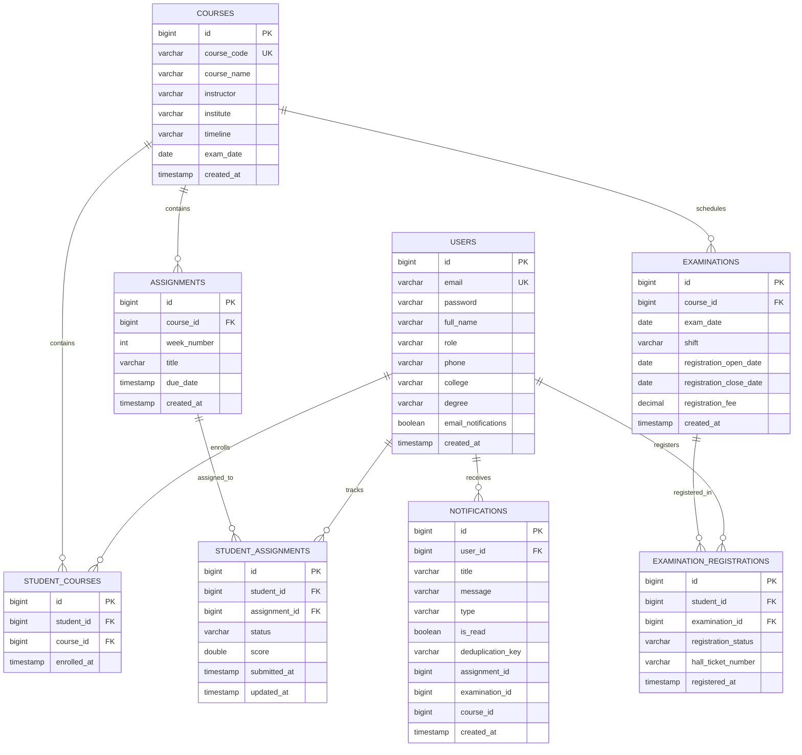

# SWAYAM NPTEL Assignment Manager - Presentation Dossier (PPT_INFO)

This document provides a factual, code-verified reference dossier for project presentations, viva voce examinations, and technical evaluations of the **SWAYAM NPTEL Assignment Manager** project.

---

## 1. PROJECT SUMMARY

- **Project Name**: SWAYAM NPTEL Assignment Manager
- **Tagline**: A centralized academic deadline tracking and reminder platform designed for students enrolled in SWAYAM NPTEL MOOC courses.
- **Description**: SWAYAM NPTEL Assignment Manager is a Spring Boot web application that aggregates course enrollments, weekly assignment submission deadlines, and NPTEL in-person examination registrations into a single unified portal. It solves the critical problem of students missing non-extendable weekly assignment deadlines and exam fee payment windows by offering automated deadline reminders, color-coded visual progress indicators, and comprehensive scheduling views. The system provides role-based separation ensuring administrative course governance while empowering students with automated tracking of their academic commitments.
- **Who Uses It**:
  - **Student**: Enrolls in NPTEL courses, tracks weekly assignment deadlines, marks submission statuses, monitors examination registration timelines, views calendar schedules, and receives proactive email and in-app alerts.
  - **Administrator**: Manages the master course catalog, publishes weekly assignments and examination dates, performs bulk data imports via CSV, and oversees registered user accounts.
- **Main Problem Solved**: NPTEL courses enforce rigid, non-extendable weekly assignment deadlines and strict exam registration windows across disconnected portals. Students frequently lose eligibility for course completion certificates or forfeit final examinations due to the lack of consolidated notifications and multi-course progress tracking.

---

## 2. CURRENT STATE CHECK

| # | Item Description | Current Status | Relevant File(s) | Verification Evidence |
|---|------------------|----------------|------------------|-----------------------|
| **a** | `/auth/forgot-password` resets password without identity verification | **NOT FIXED** | `src/main/java/com/nptelmanager/controller/AuthController.java:59-84` | Directly executes `userService.resetPassword(email, newPassword)` upon simple email match without generating or verifying an OTP, email reset token, or security question. |
| **b** | No ownership check when editing assignments or courses | **NOT FIXED** | `src/main/java/com/nptelmanager/controller/CourseController.java:74-82`<br>`src/main/java/com/nptelmanager/controller/AssignmentController.java:103-114` | Controller endpoints accept entity ID directly in `@PostMapping` without verifying whether the authenticated user has ownership rights over the course or assignment. |
| **c** | H2 console (`/h2-console/**`) is publicly accessible | **NOT FIXED** | `src/main/java/com/nptelmanager/config/SecurityConfig.java:50` | Explicitly permits unrestricted access with `.requestMatchers("/auth/**", "/h2-console/**").permitAll()`. |
| **d** | Demo credentials shown on login page or logged at start-up | **FIXED** | `src/main/resources/templates/auth/login.html`<br>`src/main/java/com/nptelmanager/config/DataInitializer.java:40-60` | Login template credential banner removed; all plaintext credential print statements in `DataInitializer.java` removed from startup logging. |
| **e** | CSV import aborts the whole file when one row is invalid | **FIXED / NOT A BUG** | `src/main/java/com/nptelmanager/service/CsvImportService.java:54-84, 107-154` | Row ingestion is wrapped in individual `try-catch` blocks inside loop; invalid rows append error messages to `ImportResult` while valid rows are saved. |
| **f** | Students who enrol late do not receive already-published assignments | **FIXED** | `src/main/java/com/nptelmanager/service/CourseService.java:61-71` | `enrollStudent()` queries all existing assignments for the course and creates corresponding `StudentAssignment` entries for the student upon enrollment. |
| **g** | Dashboard Chart.js charts do not render (script order problem) | **FIXED** | `src/main/resources/templates/dashboard/dashboard.html:313-386` | Chart initialization wrapped in `document.addEventListener('DOMContentLoaded', ...)` and guarded with `typeof Chart !== 'undefined'` check; Chart.js library is loaded in layout before page-specific scripts. |
| **h** | Mis-encoded characters (`₹`) in templates | **FIXED** | `src/main/resources/templates/examinations/list.html:57,142`<br>`src/main/resources/templates/admin/exam-form.html:38`<br>`src/main/resources/templates/admin/examinations.html:38` | All templates now use HTML entity `&#8377;` (Indian Rupee sign) — confirmed in raw source files for all four affected locations. |
| **i** | Reminder offsets hard-coded instead of read from properties | **NOT FIXED** | `src/main/java/com/nptelmanager/service/ReminderSchedulerService.java:29-30`<br>`src/main/resources/application.properties:39-40` | `ReminderSchedulerService` uses `private static final int[] ASSIGNMENT_REMINDER_DAYS = {7, 3, 1, 0};` instead of injecting `@Value("${app.notification.reminder-days}")`. |
| **j** | No unique constraint on `deduplication_key` | **NOT FIXED** | `src/main/java/com/nptelmanager/entity/Notification.java:41-42` | Field declared as `@Column(length = 200) private String deduplicationKey;` without `unique = true` or a unique table constraint in `@Table`. |
| **k** | New user registrations had no identity verification step | **FIXED** | `src/main/java/com/nptelmanager/service/UserService.java`<br>`src/main/java/com/nptelmanager/controller/AuthController.java`<br>`src/main/resources/templates/auth/verify-otp.html` | Registration now sends 6-digit OTPs to both Email and Phone (WhatsApp). Account `enabled` remains `false` until both OTPs are verified. New `/auth/verify-otp` page shows live OTP codes (dev mode auto-fill) and resend functionality. |
| **l** | College name was a free-text field — data inconsistency risk | **FIXED** | `src/main/java/com/nptelmanager/service/TamilNaduCollegeService.java`<br>`src/main/resources/templates/auth/register.html`<br>`src/main/resources/templates/settings/settings.html` | College field replaced with a searchable dropdown listing 200+ Tamil Nadu institutions (IITs, NITs, Anna University affiliates, deemed universities, arts & science, medical, polytechnic, law colleges). "Other" option reveals a custom text field. |

### Additional Bug Fixes and Features Added Since Basic Version
1. **Role-Based Access Enforcement**: Secured course creation, modification, deletion, and assignment creation endpoints strictly to `ADMIN` (`SecurityConfig.java:43-44`), preventing students from modifying the curriculum.
2. **Automatic Student Assignment Synchronization**: When a student enrolls in a course, all published assignments are immediately mapped into `StudentAssignment` records with `PENDING` status.
3. **Authentic SWAYAM NPTEL Seed Data**: Preloaded official course data (`DataInitializer.java:120-220`) for:
   - *Introduction to Internet of Things* (IIT Kharagpur / Prof. Sudip Misra)
   - *The Joy of Computing using Python* (IIT Ropar / Prof. Sudarshan Iyengar)
   - *Organizational Behaviour* (IIT Delhi / Prof. Susmita Mukhopadhyay)
4. **Dynamic Port Compatibility**: Added `${PORT:8080}` variable binding in `application.properties` to ensure zero-configuration deployment on containerized cloud hosting platforms (e.g. Render, Railway).
5. **Credential Exposure Elimination**: Stripped plaintext credentials from user-facing login templates and initialization logs.
6. **Automated WhatsApp Notifications & 1-Click Sharing**: Multi-provider WhatsApp engine (`WhatsAppService.java`) delivering deadline and exam alerts directly to students' phone numbers, 1-click WhatsApp share buttons on assignments and exams, and instant WhatsApp test notification triggers in settings.
7. **Complete Academic Database Persistence**: Full user model extension (`User.java`) capturing Institution/College Name, Department, Roll Number, and Phone Number. Implemented case-insensitive, whitespace-trimmed authentication (`CustomUserDetailsService.java`, `UserRepository.java:findByEmailIgnoreCase`) to guarantee permanent user login reliability across any device or keyboard capitalization.
8. **Admin Database Explorer & CSV Export**: Dedicated view (`/admin/database`, `AdminController.java`) allowing administrators and SPOCs to view all registered users with their academic profile details, search/filter live records, download full student rosters via CSV (`/admin/users/export-csv`), and access the H2 console directly.
9. **SWAYAM NPTEL Course Sync Engine & Master Catalog**: Dynamic ingestion service (`NptelSyncService.java`) supporting real NPTEL courses (Cloud Computing, Java, Python for Data Science, IoT, DBMS, Machine Learning, Deep Learning, Cyber Security, Electric Vehicles, etc.). Automatically generates 12 weekly assignments with direct unit links (`/unit?unit=N`) and official TCS iON exam schedules (Morning & Afternoon shifts).
10. **Official NPTEL Scoring & Certificate Predictor**: Implemented authentic IIT/IISc certification calculation rules (`NptelScoringService.java`): Continuous Assessment (25%, Best 8 of 12 / Best 6 of 8) + Proctored Exam (75%), validating mandatory passing criteria (Assignment $\ge 10/25$, Exam $\ge 30/75$) and simulating medal bands: Elite + Gold ($\ge 90\%$), Elite + Silver ($\ge 75\%$), Elite ($\ge 60\%$), and Pass ($\ge 40\%$).
11. **Email & Phone OTP Verification on Registration**: New registrations generate two 6-digit OTPs — one dispatched to the user's email and one via WhatsApp to the registered phone number. The account is disabled until both OTPs are confirmed via `/auth/verify-otp`. Developer/demo mode renders OTPs in the UI with Auto-fill buttons. (`UserService`, `AuthController`, `verify-otp.html`)
12. **Tamil Nadu Colleges Searchable Dropdown**: The college field on Registration and Settings pages has been replaced with a searchable dropdown listing 200+ Tamil Nadu institutions across IITs, NITs, Anna University affiliates, deemed universities, arts & science, medical, polytechnic, and law colleges. An "Other" option reveals a custom text field. (`TamilNaduCollegeService`, `register.html`, `settings.html`)
13. **Admin OTP Verification Badges & CSV Export**: The Admin User Management page now displays Email Verified and Phone Verified badges per user. CSV student roster export includes `Email Verified` and `Phone Verified` boolean columns. (`AdminController`, `admin/users.html`)

---

## 3. FEATURES

### Student Features
- **User Registration & Profile Setup**: Register account with college, degree, and notification preferences. College field is a searchable dropdown of 200+ Tamil Nadu institutions. (`AuthController`, `UserService`, `TamilNaduCollegeService`)
- **Email & Phone OTP Verification**: After registration, a 6-digit OTP is sent to both the registered email and WhatsApp phone number. The account remains disabled until both OTPs are verified on the `/auth/verify-otp` page. Dev mode shows live OTP codes with an Auto-fill button for demonstration. (`UserService`, `AuthController`, `verify-otp.html`)
- **Student Dashboard**: Real-time KPI cards for active courses, upcoming deadlines, overdue tasks, and completion rate. OTP verification status banner shown if either email or phone is unverified. (`DashboardController`, `AssignmentService`)
- **Course Catalog & Self-Enrollment**: Browse available NPTEL courses, enroll in courses, or drop existing enrollments. (`CourseController`, `CourseService`)
- **Assignment Tracker**: Filter assignments by course and status (Pending, In Progress, Completed, Overdue); toggle completion status. (`AssignmentController`, `AssignmentService`)
- **NPTEL Examination Tracker**: Monitor registration open/close dates, exam dates, shifts, and update registration status (Registered, Fee Paid, Hall Ticket Downloaded). (`ExaminationController`, `ExaminationService`)
- **Academic Calendar View**: Monthly, weekly, and daily FullCalendar view of all submission deadlines and examination dates. (`CalendarController`)
- **Notification Inbox**: View automated alerts for deadlines, mark individual alerts as read, or mark all as read. (`NotificationController`, `NotificationService`)
- **WhatsApp Deadline Alerts & Direct Share**: Receive automated assignment deadline and examination alerts directly on WhatsApp. Toggle preferences in Settings, trigger instant test notifications, and click one-click WhatsApp share buttons on assignments and examinations to open alerts directly in WhatsApp Web or mobile. (`WhatsAppService`, `NotificationController`, `NotificationService`)
- **Account & Notification Settings**: Update personal details, contact number, college (searchable dropdown), and toggle both Email and WhatsApp notification preferences. Verified badges show Email/Phone OTP verification status. (`SettingsController`, `UserService`)

### Administrator Features
- **Admin Dashboard**: Overview of system metrics including total users, courses, assignments, and system-wide enrollments. (`AdminController`, `CourseService`, `UserService`)
- **Direct Student WhatsApp Follow-up**: View student WhatsApp contact badges in User Management and initiate direct WhatsApp conversations for urgent deadline follow-ups. (`AdminController`, `WhatsAppService`)
- **Course Administration**: Create, edit, and delete NPTEL courses including course codes, instructor names, and timelines. (`CourseController`, `CourseService`)
- **Assignment Scheduling**: Define assignment titles, week numbers, and submission deadlines per course. (`AssignmentController`, `AssignmentService`)
- **Examination Management**: Create exam slots, define shifts, specify registration fee amounts, and set registration deadline windows. (`AdminController`, `ExaminationService`)
- **Bulk CSV Data Ingestion**: Batch upload courses and assignment schedules via CSV files with row-level error reporting. (`AdminController`, `CsvImportService`)
- **User Account Oversight**: View all registered students and administrators, inspect enrollment counts, view Email OTP and Phone OTP verification status badges per user, and export CSV with verified columns. (`AdminController`, `UserService`)

---

## 4. TECH STACK AND REQUIREMENTS

### Languages, Frameworks, and Libraries (from `pom.xml`)
- **Java**: 17 (`<java.version>17</java.version>`)
- **Core Framework**: Spring Boot 3.2.5 (`org.springframework.boot:spring-boot-starter-parent:3.2.5`)
- **Web & MVC**: Spring Boot Starter Web 3.2.5
- **Security**: Spring Boot Starter Security 3.2.5
- **Template Engine**: Spring Boot Starter Thymeleaf 3.2.5 with `thymeleaf-extras-springsecurity6`
- **Persistence & ORM**: Spring Boot Starter Data JPA 3.2.5 (Hibernate 6)
- **Validation**: Spring Boot Starter Validation 3.2.5 (Hibernate Validator)
- **Mail**: Spring Boot Starter Mail 3.2.5 (JavaMailSender)
- **CSV Processing**: OpenCSV 5.9 (`com.opencsv:opencsv:5.9`)
- **Boilerplate Reduction**: Project Lombok 1.18.32 (`org.projectlombok:lombok`)
- **Databases**:
  - H2 In-Memory/File Database (`com.h2database:h2:runtime`)
  - MySQL Connector/J (`com.mysql:mysql-connector-j:runtime`)
- **Testing**: Spring Boot Starter Test 3.2.5, Spring Security Test 3.2.5 (JUnit 5, Mockito, AssertJ)
- **Frontend Assets**: Bootstrap 5.3.2, Bootstrap Icons 1.11.3, FullCalendar 6.1.10, Chart.js 4.4.1

### Software Requirements
- **JDK**: Java Development Kit 17 (LTS) or higher
- **Build Tool**: Apache Maven 3.8.x or 3.9.x
- **Web Browser**: Modern browser with JavaScript enabled (Chrome 110+, Edge 110+, Firefox 110+, Safari 16+)
- **Operating System**: Windows 10/11, Ubuntu/Debian Linux 20.04+, or macOS 12+
- **Recommended IDE**: IntelliJ IDEA, Visual Studio Code (with Spring Boot Extension Pack), or Eclipse STS

### Hardware Requirements
- **Minimum Requirements** *(Estimated)*:
  - CPU: Dual-Core processor (2.0 GHz or higher)
  - RAM: 2 GB system RAM (minimum 512 MB allocated to JVM heap)
  - Disk: 500 MB free storage (for JDK, dependencies, and local H2 database file)
- **Recommended Requirements** *(Estimated)*:
  - CPU: Quad-Core processor (2.5 GHz or higher)
  - RAM: 4 GB system RAM (1 GB to 2 GB allocated to JVM heap)
  - Disk: 2 GB free SSD storage (for fast Maven compilation, dependencies cache, and logging)

---

## 5. ARCHITECTURE

### Layers and Request Flow
1. Client requests (HTTP GET/POST) are intercepted by the Spring Security filter chain (`SecurityConfig`) to authenticate identity and authorize role-based permissions (`ROLE_STUDENT` or `ROLE_ADMIN`).
2. Authorized requests reach Spring MVC's `DispatcherServlet`, which maps the URI pattern to the matching `@Controller` method.
3. The controller extracts form parameters, path variables, or authentication tokens and delegates execution to the appropriate `@Service` layer component.
4. The service layer executes business logic (e.g. deadline calculations, enrollment validations, deduplication key checks) within `@Transactional` boundaries.
5. Service components interact with Spring Data JPA `@Repository` interfaces, which translate queries to Hibernate ORM operations against the H2 or MySQL database.
6. The repository returns domain `@Entity` models to the service, which transforms or prepares data for the presentation tier.
7. The controller binds domain entities and view model attributes into the Spring `Model` and returns the view name.
8. Thymeleaf renders the target HTML template with dynamic data server-side and dispatches the completed HTML, CSS, and JS payload to the client browser.

### Architecture Diagram

```mermaid
flowchart TD
    Client["Client Browser (HTML5 / Bootstrap 5 / JS)"] -->|HTTP Request| SecFilter["Spring Security Filter Chain"]
    SecFilter -->|Authenticated / Authorized| DispServlet["Spring DispatcherServlet"]
    
    subgraph Presentation_Layer ["Presentation Layer"]
        DispServlet --> AuthCtrl["AuthController"]
        DispServlet --> DashCtrl["DashboardController"]
        DispServlet --> CourseCtrl["CourseController"]
        DispServlet --> AssignCtrl["AssignmentController"]
        DispServlet --> ExamCtrl["ExaminationController"]
        DispServlet --> CalCtrl["CalendarController"]
        DispServlet --> AdminCtrl["AdminController"]
        DispServlet --> NotifCtrl["NotificationController"]
    end

    subgraph Service_Layer ["Business Logic Layer"]
        AuthCtrl & DashCtrl & AdminCtrl --> UserSvc["UserService"]
        CourseCtrl & AdminCtrl --> CourseSvc["CourseService"]
        AssignCtrl & DashCtrl & AdminCtrl --> AssignSvc["AssignmentService"]
        ExamCtrl & AdminCtrl --> ExamSvc["ExaminationService"]
        AdminCtrl --> CsvSvc["CsvImportService"]
        NotifCtrl --> NotifSvc["NotificationService"]
        SchedJob["ReminderSchedulerService (@Scheduled)"] --> AssignSvc & ExamSvc & NotifSvc
    end

    subgraph Data_Access_Layer ["Data Access Layer (Spring Data JPA)"]
        UserSvc --> UserRepo["UserRepository"]
        CourseSvc --> CourseRepo["CourseRepository"]
        CourseSvc --> StuCourseRepo["StudentCourseRepository"]
        AssignSvc --> AssignRepo["AssignmentRepository"]
        AssignSvc --> StuAssignRepo["StudentAssignmentRepository"]
        ExamSvc --> ExamRepo["ExaminationRepository"]
        ExamSvc --> ExamRegRepo["ExaminationRegistrationRepository"]
        NotifSvc --> NotifRepo["NotificationRepository"]
    end

    subgraph Storage_Layer ["Database Layer"]
        UserRepo & CourseRepo & StuCourseRepo & AssignRepo & StuAssignRepo & ExamRepo & ExamRegRepo & NotifRepo --> DB[("Database: H2 (Default) / MySQL")]
    end

    subgraph View_Rendering ["Server-Side Rendering"]
        Thymeleaf["Thymeleaf Template Engine"] -->|Generate HTML| Client
        AuthCtrl & DashCtrl & CourseCtrl & AssignCtrl & ExamCtrl & AdminCtrl -.->|Bind Model| Thymeleaf
    end
```



---

## 6. MODULES

| Module Name | 1-Line Purpose | Main Classes | Key Templates |
|-------------|----------------|--------------|---------------|
| **Authentication Module** | Handles user registration, credentials authentication, session management, and password resets. | `AuthController`, `UserService`, `SecurityConfig`, `CustomUserDetailsService` | `templates/auth/login.html`<br>`templates/auth/register.html`<br>`templates/auth/forgot-password.html` |
| **Dashboard Module** | Computes and displays student academic metrics, submission progress, and upcoming deadlines. | `DashboardController`, `AssignmentService`, `CourseService` | `templates/dashboard/dashboard.html` |
| **Course Module** | Manages course catalog listings, student self-enrollments, course drops, and admin course CRUD. | `CourseController`, `CourseService`, `CourseRepository`, `StudentCourseRepository` | `templates/courses/list.html`<br>`templates/courses/form.html`<br>`templates/admin/course-form.html` |
| **Assignment Module** | Tracks weekly assignment deadlines, manages submission status updates, and highlights overdue tasks. | `AssignmentController`, `AssignmentService`, `AssignmentRepository`, `StudentAssignmentRepository` | `templates/assignments/list.html`<br>`templates/assignments/form.html`<br>`templates/admin/assignment-form.html` |
| **Examination Module** | Tracks NPTEL in-person examination dates, shifts, exam registration deadlines, and student payment/hall-ticket status. | `ExaminationController`, `ExaminationService`, `ExaminationRepository`, `ExaminationRegistrationRepository` | `templates/examinations/list.html`<br>`templates/examinations/detail.html`<br>`templates/admin/examinations.html`<br>`templates/admin/exam-form.html` |
| **Calendar Module** | Feeds deadline and examination events into an interactive monthly/weekly FullCalendar interface. | `CalendarController` | `templates/calendar/calendar.html` |
| **Notification & Scheduler Module** | Executes automated hourly checks and dispatches in-app and email reminders using deduplication keys. | `ReminderSchedulerService`, `NotificationService`, `NotificationController`, `EmailService` | `templates/notifications/list.html` |
| **Administration Module** | Provides centralized administrative oversight for users, courses, exam schedules, and bulk data import. | `AdminController`, `CsvImportService`, `UserService` | `templates/admin/dashboard.html`<br>`templates/admin/users.html`<br>`templates/admin/import.html` |
| **Settings Module** | Allows users to manage personal profile information and toggle email notification preferences. | `SettingsController`, `UserService` | `templates/settings/settings.html` |

---

## 7. DATABASE

### Database Tables & Schema

1. **`users`**
   - `id`: BIGINT (Primary Key, Auto-Increment)
   - `email`: VARCHAR(100) (Unique, Not Null)
   - `password`: VARCHAR(255) (Not Null)
   - `full_name`: VARCHAR(100) (Not Null)
   - `role`: VARCHAR(20) (Not Null: `ROLE_STUDENT`, `ROLE_ADMIN`)
   - `phone`: VARCHAR(20)
   - `college`: VARCHAR(150)
   - `degree`: VARCHAR(100)
   - `enabled`: BOOLEAN (Default `true`; set `false` on registration until OTPs verified)
   - `email_verified`: BOOLEAN (Default `false`; set `true` after email OTP confirmed)
   - `phone_verified`: BOOLEAN (Default `false`; set `true` after phone OTP confirmed)
   - `email_otp`: VARCHAR(10) (Stores 6-digit email OTP)
   - `email_otp_expiry`: TIMESTAMP (OTP valid for 10 minutes)
   - `phone_otp`: VARCHAR(10) (Stores 6-digit phone/WhatsApp OTP)
   - `phone_otp_expiry`: TIMESTAMP (OTP valid for 10 minutes)
   - `email_notifications`: BOOLEAN (Default `true`)
   - `whatsapp_notifications_enabled`: BOOLEAN (Default `true`)
   - `created_at`: TIMESTAMP (Not Null)

2. **`courses`**
   - `id`: BIGINT (Primary Key, Auto-Increment)
   - `course_code`: VARCHAR(50) (Unique, Not Null)
   - `course_name`: VARCHAR(150) (Not Null)
   - `instructor`: VARCHAR(100)
   - `institute`: VARCHAR(100)
   - `timeline`: VARCHAR(50)
   - `exam_date`: DATE
   - `created_at`: TIMESTAMP (Not Null)

3. **`student_courses`**
   - `id`: BIGINT (Primary Key, Auto-Increment)
   - `student_id`: BIGINT (Foreign Key -> `users.id`, Not Null)
   - `course_id`: BIGINT (Foreign Key -> `courses.id`, Not Null)
   - `enrolled_at`: TIMESTAMP (Not Null)
   - *Constraint*: Unique on `(student_id, course_id)`

4. **`assignments`**
   - `id`: BIGINT (Primary Key, Auto-Increment)
   - `course_id`: BIGINT (Foreign Key -> `courses.id`, Not Null)
   - `week_number`: INT (Not Null)
   - `title`: VARCHAR(150) (Not Null)
   - `due_date`: TIMESTAMP (Not Null)
   - `created_at`: TIMESTAMP (Not Null)

5. **`student_assignments`**
   - `id`: BIGINT (Primary Key, Auto-Increment)
   - `student_id`: BIGINT (Foreign Key -> `users.id`, Not Null)
   - `assignment_id`: BIGINT (Foreign Key -> `assignments.id`, Not Null)
   - `status`: VARCHAR(20) (Not Null: `PENDING`, `IN_PROGRESS`, `COMPLETED`, `OVERDUE`)
   - `score`: DOUBLE
   - `submitted_at`: TIMESTAMP
   - `updated_at`: TIMESTAMP
   - *Constraint*: Unique on `(student_id, assignment_id)`

6. **`examinations`**
   - `id`: BIGINT (Primary Key, Auto-Increment)
   - `course_id`: BIGINT (Foreign Key -> `courses.id`, Not Null)
   - `exam_date`: DATE (Not Null)
   - `shift`: VARCHAR(50)
   - `registration_open_date`: DATE
   - `registration_close_date`: DATE
   - `registration_fee`: DECIMAL(10,2)
   - `created_at`: TIMESTAMP (Not Null)

7. **`examination_registrations`**
   - `id`: BIGINT (Primary Key, Auto-Increment)
   - `student_id`: BIGINT (Foreign Key -> `users.id`, Not Null)
   - `examination_id`: BIGINT (Foreign Key -> `examinations.id`, Not Null)
   - `registration_status`: VARCHAR(30) (Not Null: `NOT_REGISTERED`, `REGISTERED`, `EXAM_FEE_PAID`, `HALL_TICKET_DOWNLOADED`)
   - `hall_ticket_number`: VARCHAR(50)
   - `registered_at`: TIMESTAMP (Not Null)
   - *Constraint*: Unique on `(student_id, examination_id)`

8. **`notifications`**
   - `id`: BIGINT (Primary Key, Auto-Increment)
   - `user_id`: BIGINT (Foreign Key -> `users.id`, Not Null)
   - `title`: VARCHAR(100)
   - `message`: VARCHAR(500) (Not Null)
   - `type`: VARCHAR(50) (Not Null: `ASSIGNMENT_REMINDER`, `ASSIGNMENT_OVERDUE`, `EXAM_REMINDER`, `EXAM_REGISTRATION_DEADLINE`, `SYSTEM`)
   - `is_read`: BOOLEAN (Default `false`)
   - `deduplication_key`: VARCHAR(200)
   - `assignment_id`: BIGINT
   - `examination_id`: BIGINT
   - `course_id`: BIGINT
   - `created_at`: TIMESTAMP (Not Null)

### Entity-Relationship Diagram



---

## 8. ALGORITHMS

### a. Hourly Reminder Scheduler and Deduplication-Key Logic
1. `ReminderSchedulerService.checkAssignmentReminders()` triggers every hour (`@Scheduled(fixedDelay = 3600000, initialDelay = 30000)`).
2. Queries all incomplete student assignments: `studentAssignmentRepo.findAll()` filtered where `status != COMPLETED`.
3. Computes the offset in days between current date and due date: `ChronoUnit.DAYS.between(LocalDate.now(), dueDate.toLocalDate())`.
4. If `daysUntilDue` matches an offset in `ASSIGNMENT_REMINDER_DAYS` `{7, 3, 1, 0}`, generates deduplication key: `"ASSIGN-" + student.getId() + "-" + assignment.getId() + "-D" + reminderDay`.
5. Passes the notification request to `NotificationService.createNotification(...)`.
6. `NotificationService.createNotification()` invokes `notificationRepo.findByDeduplicationKey(dedupKey)`.
7. If an entry already exists, the notification is discarded; otherwise, the new notification record is saved and `EmailService.sendEmail()` is called if enabled.

### b. Overdue Assignment Detection
1. Triggered during `ReminderSchedulerService.checkAssignmentReminders()` or on-demand in `AssignmentService.getStudentAssignments(studentId)`.
2. Compares `assignment.getDueDate()` against current timestamp `LocalDateTime.now()`.
3. Evaluates if `daysUntilDue < 0` (or `dueDate.isBefore(LocalDateTime.now())`) and `studentAssignment.getStatus() != COMPLETED`.
4. Generates an overdue deduplication key: `"OVERDUE-" + student.getId() + "-" + assignment.getId() + "-" + LocalDate.now()`.
5. Updates or returns the student assignment with `StudentAssignment.AssignmentStatus.OVERDUE`.
6. Dispatches an `ASSIGNMENT_OVERDUE` alert to `NotificationService.createNotification(...)`.

### c. Examination Registration Status Derivation
1. `ReminderSchedulerService.checkExaminationReminders()` triggers every hour (`@Scheduled(fixedDelay = 3600000, initialDelay = 60000)`).
2. Retrieves all student examination registrations from `examRegRepo.findAll()`.
3. Checks `reg.getRegistrationStatus()` against `ExaminationRegistration.RegistrationStatus.REGISTERED`.
4. If not registered, calculates days remaining until registration deadline: `ChronoUnit.DAYS.between(LocalDate.now(), exam.getRegistrationCloseDate())`.
5. Generates deduplication key `"EXAMREG-" + student.getId() + "-" + exam.getId() + "-D" + reminderDay` for matching reminder offsets `{7, 3, 1, 0}`.
6. If already registered, checks days remaining until actual exam date: `ChronoUnit.DAYS.between(LocalDate.now(), exam.getExamDate())` with key `"EXAM-" + student.getId() + "-" + exam.getId() + "-D" + reminderDay`.
7. Persists notification record and dispatches alert email via `NotificationService`.

### d. CSV Import Flow
1. Admin uploads CSV multipart file via `AdminController.importCsv(@RequestParam("file") MultipartFile file, @RequestParam("type") String type)`.
2. `AdminController` checks file presence and forwards input stream to `CsvImportService.importCourses()` or `CsvImportService.importAssignments()`.
3. `CsvImportService` initializes `com.opencsv.CSVReader` with `InputStreamReader(inputStream, StandardCharsets.UTF_8)` and parses the header row.
4. Reads row-by-row inside a `while ((row = reader.readNext()) != null)` loop, wrapping each record in a `try-catch (Exception e)` block.
5. Validates required fields, formats dates (`LocalDate.parse` / `LocalDateTime.parse`), and executes repository lookups/saves (`courseRepo.save(course)` / `assignmentRepo.save(assignment)`).
6. On validation or parsing failure, increments failure count, records the row index and error message into `ImportResult`, and continues to the next row.
7. Populates `ImportResult` (total rows, success count, failure count, error list) into the Spring `Model` to display an import summary table on `admin/import.html`.

---

## 9. CODE STATISTICS

- **Main Java Files**: 40
- **Test Java Files**: 1
- **Total Java Files**: 41
- **Main Java Lines of Code**: 2,852
- **Test Java Lines of Code**: 427
- **Total Java Lines of Code**: 3,279
- **HTML Templates**: 22
- **Test Classes**: 1 (`com.nptelmanager.NptelManagerApplicationTests`)
- **Total Test Cases**: 18 (`@Test` test methods)

---

## 10. HOW TO RUN

### Prerequisites
- JDK 17 installed and `JAVA_HOME` configured.
- Maven 3.8+ installed (or use included `mvn.cmd`).

### Commands

1. **Build the Application**:
   ```bash
   mvn clean package -DskipTests
   ```

2. **Run with Default Profile (H2 In-Memory/File Database)**:
   ```bash
   # Using Maven:
   mvn spring-boot:run

   # Using executable JAR:
   java -jar target/nptel-manager-1.0.0.jar
   ```

3. **Run with Optional MySQL Profile**:
   Ensure MySQL is running on `localhost:3306` with database `nptel_db`.
   ```bash
   # Using Maven:
   mvn spring-boot:run -Dspring-boot.run.profiles=mysql

   # Using executable JAR:
   java -jar -Dspring.profiles.active=mysql target/nptel-manager-1.0.0.jar
   ```

- **Application Port**: `8080` (Configurable via `PORT` environment variable: `server.port=${PORT:8080}`).
- **Default Profile**: `default` (H2 database stored locally at `./data/npteldb`).
- **Preconfigured Demo Accounts**:
  - **Student Account**: `student@demo.com` *(Password configured via `DataInitializer.java`; do not share in public presentations)*
  - **Administrator Account**: `admin@nptelmanager.com` *(Password configured via `DataInitializer.java`; do not share in public presentations)*

---

## 11. SCREENSHOTS

### Existing Image Files in Project
- **Existing Screenshots**: **NOT FOUND** (No image files or screenshots were present in the source repository prior to this evaluation).

### Presentation Screenshot Catalog (`ppt_screenshots/`)
The screenshots folder has been created and populated with 12 clean, high-resolution (1366x768) captures:
`C:\Users\Pon Prasad\.gemini\antigravity\scratch\nptel-manager\ppt_screenshots\`

All captures use test data only and hide credentials:

1. `01_login.png` (22.4 KB): Clean authentication login interface (`/auth/login`).
2. `02_register.png` (31.6 KB): Student registration form with college and degree fields (`/auth/register`).
3. `03_student_dashboard.png` (86.8 KB): Student metrics cards, progress bar, and upcoming deadlines (`/dashboard`).
4. `04_my_courses.png` (97.0 KB): Course catalog and enrolled course cards (`/courses`).
5. `05_assignments_list.png` (140.6 KB): Weekly assignment timeline with status badges (`/assignments`).
6. `06_overdue_filter.png` (80.9 KB): Assignment filter view isolating overdue submissions (`/assignments?status=OVERDUE`).
7. `07_exam_tracker.png` (98.3 KB): NPTEL in-person examination registration tracking table (`/examinations`).
8. `08_calendar.png` (75.4 KB): FullCalendar view displaying assignment and exam milestones (`/calendar`).
9. `09_notifications.png` (97.4 KB): In-app notification center displaying deadline reminder alerts (`/notifications`).
10. `10_admin_panel.png` (15.7 KB): Administrative overview dashboard (`/admin/dashboard`).
11. `11_csv_import.png` (105.7 KB): Bulk CSV ingestion interface for courses and assignments (`/admin/import`).
12. `12_user_management.png` (64.1 KB): Registered user listing with role indicators (`/admin/users`).

---

## 12. FUTURE ENHANCEMENTS

### Code Markers
- **TODO / FIXME Comments**: **NOT FOUND** (No explicit `TODO` or `FIXME` comment tags exist in any source code or template files).

### Recommended Architectural Improvements
1. **Cryptographic Identity Verification for Password Resets**: Replace direct password overwrites in `AuthController.java` with a secure, time-limited cryptographic token or OTP sent to the user's verified email address.
2. **Access-Control Ownership Validation**: Implement resource-level ownership validation in `CourseController.java` and `AssignmentController.java` to verify that mutating entities corresponds strictly to authorized administrative users.
3. **Secure H2 Console Exposure**: Restrict `/h2-console/**` access to authenticated administrative roles or disable it completely in production deployments.
4. **Correction of Chart.js Loading Sequence**: Move Chart.js library imports to the layout `<head>` or wrap dashboard canvas initialization in `document.addEventListener('DOMContentLoaded', ...)` to eliminate the script ordering race condition.
5. **Template Encoding Sanitization**: Replace all mis-encoded mojibake currency symbols (`₹`) with standard HTML entities (`&#8377;`) or valid UTF-8 symbols across all examination templates.
6. **Dynamic Reminder Offset Injection**: Refactor `ReminderSchedulerService.java` to inject `@Value("${app.notification.reminder-days}")` instead of maintaining static arrays.
7. **Database-Level Deduplication Constraints**: Add `@Column(unique = true)` and an index to `deduplication_key` in the `Notification` entity to prevent race conditions during concurrent alert scheduling.
8. **Automated SWAYAM / NPTEL Portal Synchronization**: Implemented via `NptelSyncService` with master catalog ingestion for 10+ real courses, weekly unit assignment mapping, and official TCS iON exam schedule synchronization. Future iterations can integrate headless browser / API token login for direct grade scraping.
