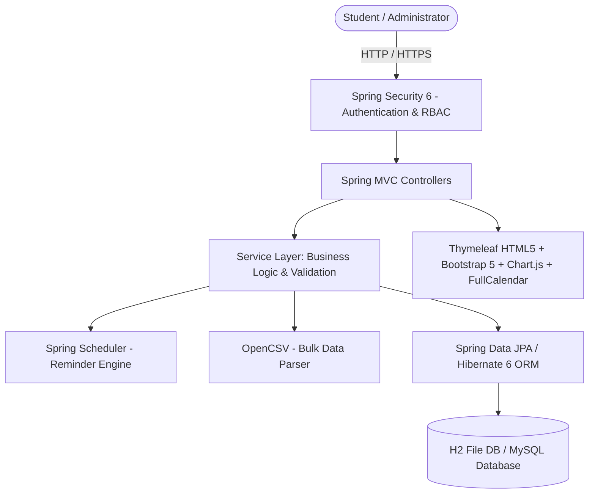
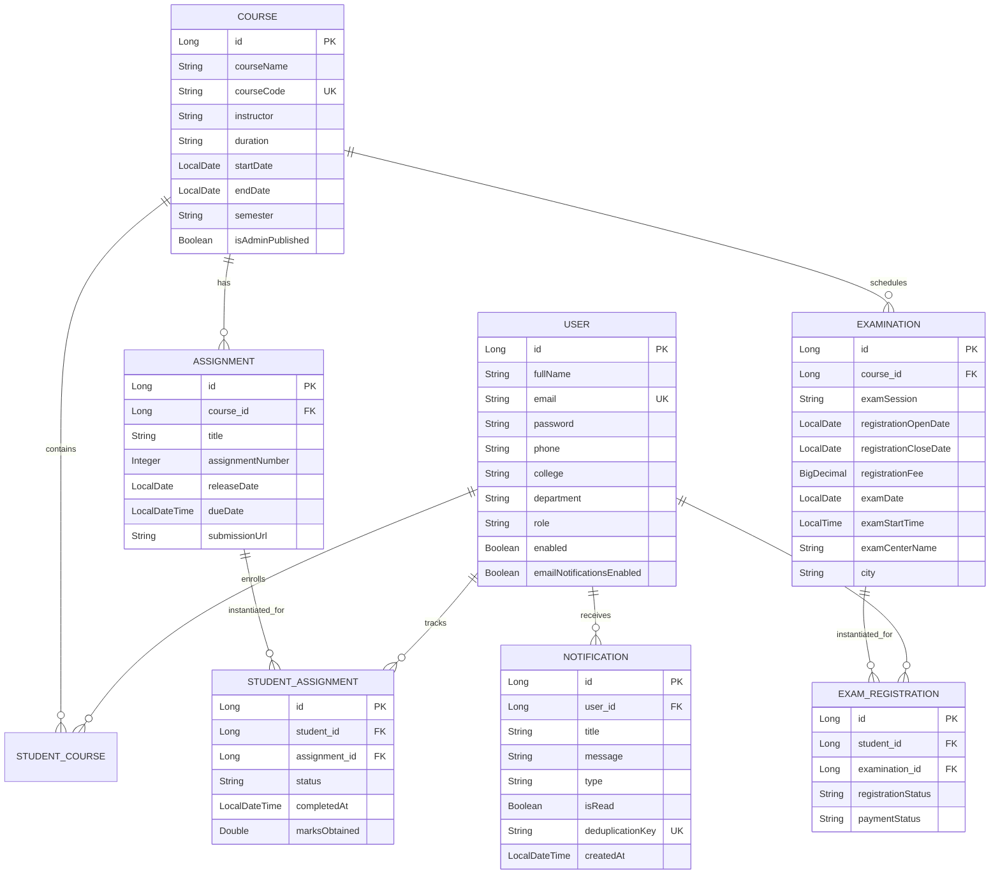

# SWAYAM NPTEL Assignment Manager — Comprehensive Project Documentation

## 1. Executive Summary & Project Objective

The **SWAYAM NPTEL Assignment Manager** is a centralized full-stack web application designed to help college students streamline their SWAYAM/NPTEL academic journey. It automates deadline tracking, assignment lifecycle management, exam registration reminders, and academic calendar visualization.

### Key Objectives
* **Centralized Course Tracker**: Manage enrolled NPTEL courses, semester schedules, and instructors.
* **Assignment Lifecycle Management**: Track statuses (*Not Started*, *In Progress*, *Completed*, *Overdue*), scores, and direct submission URLs.
* **Intelligent Reminder Engine**: Scheduled automated notifications (7-day, 3-day, 1-day, and deadline-day alerts) with deduplication keys to prevent spam.
* **Examination Tracker**: Monitor exam registration windows, fees, payment statuses, and exam center details with Google Maps navigation.
* **Academic Calendar**: Visual interactive calendar showing color-coded deadlines, registration windows, and examination schedules.
* **Administrative Portal**: Official course/exam publishing, user management, and bulk CSV data import with sample templates.

---

## 2. Technology Stack & Architecture



* **Backend**: Java 17+, Spring Boot 3.2.5, Spring MVC, Spring Data JPA, Spring Security 6, Spring Scheduler, Jakarta Mail.
* **Frontend**: Thymeleaf template engine, HTML5, CSS3, JavaScript, Bootstrap 5.3, Chart.js 4.4, FullCalendar 6.1, Bootstrap Icons.
* **Database**: H2 (embedded file-based by default at `./data/npteldb`), MySQL-ready with dedicated profile.
* **Build Tool**: Apache Maven 3.9+.

---

## 3. Database Schema & Entity Relationships



---

## 4. Key Algorithms & System Designs

### 4.1. Automatic Overdue Detection
The application does not rely solely on cron jobs to update assignment statuses. Each `StudentAssignment` evaluates its overdue state dynamically:
$$\text{isOverdue} = (\text{status} \neq \text{COMPLETED}) \land (\text{dueDate} < \text{LocalDateTime.now()})$$
When a student visits their dashboard or assignment list, `assignmentService.syncOverdueStatuses(student)` synchronizes database records.

### 4.2. Scheduled Reminder Engine & Deduplication
The `ReminderSchedulerService` runs hourly (`@Scheduled(cron = "0 0 * * * *")`):
* Computes remaining days until deadline: $\Delta d = \text{dueDate} - \text{now}$.
* Generates a unique deduplication key:
  $$\text{Key} = \text{ASSIGN-} + \text{userId} + \text{"-"} + \text{assignmentId} + \text{"-D"} + \text{daysLabel}$$
* If a notification with this key already exists in the database, the system skips it, ensuring zero redundant notifications across server restarts.

### 4.3. Data Isolation & Security Architecture
* Every student query is strictly scoped to the authenticated user ID (`WHERE sa.student.id = :studentId`).
* Passwords are encrypted using standard **BCrypt** with adaptive work factor.
* Role-based endpoints: `/admin/**` strictly restricted to `ROLE_ADMIN`.

---

## 5. Viva / Oral Examination Q&A Guide

### Q1: Why did you choose Spring Boot for this application?
> **Answer**: Spring Boot simplifies Java enterprise development by providing production-ready defaults, dependency management (starters), embedded Tomcat server, and seamless integration with Spring Data JPA and Spring Security. It eliminates boilerplate XML configuration and enables modular, maintainable architecture.

### Q2: How does the notification system ensure that duplicate reminders are not sent?
> **Answer**: We implemented a deterministic **deduplication key** algorithm. For example, for an assignment due in 3 days, the key is formatted as `ASSIGN-{userId}-{assignmentId}-D3`. Before inserting a notification, the repository checks `notificationRepository.existsByDeduplicationKey(...)`. Even across scheduled runs or server restarts, each reminder milestone is sent at most once.

### Q3: How is student data kept isolated and secure?
> **Answer**: Security is enforced at two layers:
> 1. **URL & Role Level**: Spring Security filters restrict administrative actions to `ROLE_ADMIN`.
> 2. **Data & Query Level**: All student queries (`StudentCourseRepository`, `StudentAssignmentRepository`, `NotificationRepository`) query records explicitly matching the authenticated principal (`UserDetails.getUsername()`), ensuring no student can read or mutate another student's courses or grades.

### Q4: How is database portability achieved (H2 vs MySQL)?
> **Answer**: By leveraging Spring Data JPA and Hibernate ORM, SQL dialect abstraction is preserved. The application uses standard JPQL and H2 file-based storage for out-of-the-box local execution, while supporting MySQL in production via Spring Profiles (`--spring.profiles.active=mysql` and `application-mysql.properties`).

### Q5: How does the CSV import functionality work?
> **Answer**: `CsvImportService` uses OpenCSV to parse multipart uploaded `.csv` files. It performs header validation, type parsing (dates/times), checks for foreign key existence (e.g. course code resolution), skips duplicate records, and transactional batch-inserts assignments and exams while automatically binding them to enrolled students.

---

## 6. Setup & Execution Commands

### Default Startup (Local H2 Database)
```bash
# Windows
run.bat

# Or Maven directly
mvn spring-boot:run
```

### Running Test Suite
```bash
# Windows
run-tests.bat

# Or Maven directly
mvn test
```

### Production Mode (MySQL)
```bash
mvn spring-boot:run -Dspring-boot.run.profiles=mysql
```
